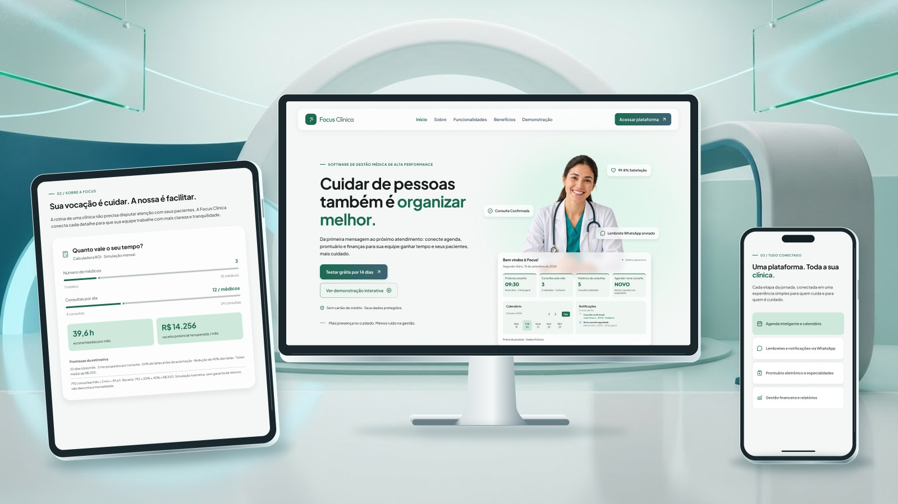

# Focus Clínica — Landing Page

> **Slogan:** _Tecnologia que organiza. Cuidado que aproxima._

A landing page do **Focus Clínica** foi desenvolvida para apresentar um software de gestão médica de alta performance. A plataforma conecta agenda, prontuário eletrônico por especialidades e gestão financeira para otimizar o tempo das equipes de saúde e humanizar o atendimento aos pacientes.

🔗 **Demonstração da Landing Page:** [focus-clinica.vercel.app](https://focus-clinica.vercel.app/)

🔗 **Protótipo no Figma:** [Design do Focus Clínica no Figma](https://www.figma.com/design/ctNGaNMeS665UBKFjH1aiX/Focus-Clinica---LP?node-id=53-7&t=c8QtKKv6jcIK2l8V-1)

🔗 **Plataforma oficial:** [focus-clinica.netlify.app](https://focus-clinica.netlify.app/)

🔗 **Documentação do projeto:** [Notion](https://app.notion.com/p/DOCUMENTA-O-DO-PROJETO-FRONT-END-3feeed34bfcc8000b011c7579a7b824e)



## Equipe

| Integrante                                                                         | Atuação                        |
| ---------------------------------------------------------------------------------- | ------------------------------ |
| [Claudia Ferreira de Mello](https://www.linkedin.com/in/claudia-ferreira-de-mello) | Design                         |
| [Neto Mendes](https://github.com/netoMendes21)                                     | Desenvolvimento web Full-Stack |
| [Jonathan Lima](https://github.com/mrjonc)                                         | Desenvolvimento web            |
| [Danielle Braga](https://github.com/daniebraga)                                    | Desenvolvimento web            |

---

## Sumário

- [Equipe](#equipe)
- [Visão Geral e Diferenciais](#visão-geral-e-diferenciais)
- [Funcionalidades e Módulos](#funcionalidades-e-módulos)
- [Calculadora ROI (Simulação em Tempo Real)](#calculadora-roi-simulação-em-tempo-real)
- [Arquitetura de JavaScript & Efeitos Visuais](#arquitetura-de-javascript--efeitos-visuais)
- [Integração com API](#integração-com-api)
- [Validação do Formulário](#validação-do-formulário)
- [Design System & UI Architecture](#design-system--ui-architecture)
- [Responsividade e Acessibilidade](#responsividade-e-acessibilidade)
- [Tecnologias Utilizadas](#tecnologias-utilizadas)
- [Estrutura do Projeto](#estrutura-do-projeto)
- [Como Executar o Projeto Localmente](#como-executar-o-projeto-localmente)
- [Testes](#testes)
- [Segurança e LGPD](#segurança-e-lgpd)
- [Publicação e Colaboração](#publicação-e-colaboração)
- [Pendências de Informação](#pendências-de-informação)

---

## Visão Geral e Diferenciais

O projeto foi construído do zero com foco em **alta performance visual, carregamento ultrarrápido e semântica web refinada**.

- **Métricas de Impacto Exibidas:**
  - **+150k** consultas agendadas.
  - **99,8%** de taxa de satisfação dos pacientes.
  - **45%** de redução na taxa de ausências via lembretes automáticos no WhatsApp.
  - **+28%** de taxa de ocupação da agenda e **32 horas poupadas por mês**.
- **Comparativo de Valor:** Exibição clara do contraste entre a gestão tradicional (planilhas e confirmações manuais) e a automação do Focus Clínica.
- **Formulário / Trial (14 Dias):** Validação dos campos e aceite dos termos antes do acesso à plataforma. A landing page não processa cadastro nem ativa testes; isso depende da plataforma oficial.

---

## Funcionalidades e Módulos

1. **Agenda Inteligente & Calendário:** Visualizações por dia, semana e profissional; bloqueios, retornos e status em tempo real.
2. **Lembretes via WhatsApp:** Confirmações automáticas para redução de faltas.
3. **Prontuário Eletrônico & Evolução Clínica:** Histórico centralizado por área de atuação e acompanhamento contínuo do paciente.
4. **Módulo de Especialidades:** Configuração e gestão de áreas médicas (Pediatria, Clínica Geral, Cardiologia, Dermatologia, Psicologia, Nutrição).
5. **Gestão Financeira:** Relatórios de receitas, repasses médicos e indicadores de desempenho.

---

## Calculadora ROI (Simulação em Tempo Real)

A landing page inclui uma **Calculadora de Retorno sobre Investimento (ROI)** desenvolvida em JavaScript Vanilla (`roi-calculator.js`). Ela permite aos gestores simularem os ganhos mensais e o tempo economizado com a automação da clínica.

### Fórmulas Aplicadas

- **Consultas Mensais:**

  $$\text{Consultas Totais} = \text{Médicos} \times \text{Consultas/Dia} \times 22 \text{ (dias úteis)}$$

- **Horas Economizadas:**

  $$\text{Horas Poupadas} = \frac{\text{Consultas Totais} \times 3 \text{ min}}{60}$$

### Recursos do Script

- **Internacionalização de Números (`Intl.NumberFormat`):** Formatação nativa em `pt-BR` para horas, numerais simples e moeda corrente (BRL sem decimais).
- **Preenchimento Dinâmico de Slider (`--range-progress`):** Atualização via CSS Custom Property para preenchimento gradual da barra de ajuste conforme a interação.
- **Leitura Acessível (A11y):** Atualização contínua de atributos `aria-valuetext` para leitores de tela durante o ajuste dos _sliders_.

---

## Arquitetura de JavaScript & Efeitos Visuais

A lógica client-side é estruturada em módulos focados em performance e acessibilidade:

1. **`roi-calculator.js` (Simulador de Impacto Financeiro):**
   - Reatividade nativa acionada pelo evento `input` sem dependência de bibliotecas externas.
   - Ajuste contextual de plurais/singulares e sufixos orientados por breakpoints (ajuste dinâmico para telas maiores/menores via `matchMedia`).

2. **`navigation.js` (Navegação & Scroll Spy):**
   - **Reset Inteligente:** Limpa o hash da URL e reseta o scroll no recarregamento usando `history.scrollRestoration = "manual"`.
   - **Scroll Spy via RAF:** Atualiza o atributo `aria-current="location"` no link ativo utilizando `requestAnimationFrame` para evitar o retrabalho de renderização do navegador (_layout thrashing_).
   - **Controle de Interação:** Prioriza a seleção por clique por 1,2s, liberando o acompanhamento dinâmico assim que o usuário faz _scroll_, `wheel` ou `touchstart`.
   - **Menu Mobile Acessível:** Gerenciamento de `aria-expanded`, suporte à tecla `Escape` (com retorno de foco para o botão de alternância) e fechamento ao clicar fora ou perder o foco (`focusout`).

3. **`page-effects.js` (Animações & Efeitos de Scroll):**
   - **Ajuste Dinâmico de Dimensões:** Utiliza `ResizeObserver` para sincronizar variáveis CSS (`--header-height` e `--preview-height`) em tempo real.
   - **Revelação Granular por Âncoras:** Emprega `IntersectionObserver` com elementos `span.reveal-anchor` injetados dinamicamente para animar cards e textos individualmente com escalonamento de atraso (`--reveal-delay`).
   - **Contadores de Desempenho:** Contagem progressiva interpolada via matemática de suavização (_cubic easing_) configurada através de data-attributes (`data-count`, `data-prefix`, `data-suffix`).
   - **Carrosséis Touch Nativo (Mobile):** Controles dinâmicos de carrossel com suporte a navegação por setas de teclado, drag/swipe e sincronização com leitores de tela.

4. **`landing-interactions.js` (Funcionalidades):**
   - Alternância por clique e teclado, com setas, Home e End.
   - Prévias criadas sob demanda a partir do conteúdo já presente na página.

5. **`trial-form.js` (Validação do Formulário):**
   - Validação dos campos e dos termos antes do redirecionamento, sem envio dos dados preenchidos.

6. **`team-members.js` (Configuração da Equipe):**
   - Usernames, cargos, LinkedIn, habilidades e fallbacks locais.

7. **`github-profiles.js` (Serviço da API):**
   - Consulta, normalização, cache, timeout e tratamento de erros dos perfis públicos.

8. **`team.js` (Apresentação da Equipe):**
   - Template reutilizável, skeletons, fotos otimizadas e falhas individuais.

Os controles dos carrosséis agrupam leituras por quadro de animação e só atualizam
o DOM quando o card ativo muda. As prévias das funcionalidades são criadas apenas
na primeira seleção de cada aba.

---

## Integração com API

**API escolhida:** API REST pública do GitHub.

**Endpoint:** `GET https://api.github.com/users/{username}`.

**Finalidade:** nome, foto e link do GitHub nos cards da equipe. Cargo, LinkedIn
e habilidades são configurados localmente. A bio pública não substitui as stacks.

Edite `src/js/team-members.js` para adicionar, remover ou reordenar integrantes:

```js
{
  username: "seu-username",
  role: "Desenvolvedor web",
  linkedin: "https://www.linkedin.com/in/seu-perfil/",
  name: "Nome usado se não houver dados disponíveis",
  skills: ["JavaScript", "CSS", "HTML"]
}
```

Nome e foto da API têm prioridade. Dados locais completam ausências ou
falhas. Nome ausente na resposta válida usa o login, conforme a normalização
do serviço. Integrantes sem GitHub, como Claudia, usam dados locais; `photo`
aceita uma imagem em `assets/img`, e `photoPosition` ajusta o recorte com CSS.
As habilidades são exibidas como `JavaScript | CSS | HTML`, a partir de `skills`.

O serviço mantém em cache apenas nome, foto e link do perfil. Usa `fetch()`,
requisições paralelas e compartilhamento de consultas
simultâneas para o mesmo username. O cache dura uma hora e preserva perfis de
até sete dias como fallback em falhas. Há timeout de dez segundos, pausa após
erros e tratamento de 403, 404, 429, JSON inválido e falhas de conexão. Nenhum
token é incluído no frontend. As fotos do GitHub são solicitadas em 144 px.

---

## Validação do Formulário

O botão de teste grátis do hero leva ao formulário. O botão “Começar meus 14 dias
grátis” só navega para a plataforma oficial depois de validar:

- Nome e nome da clínica, rejeitando campos vazios ou somente com espaços.
- Formato do e-mail.
- WhatsApp brasileiro com DDD, com dez ou onze dígitos e prefixo +55 opcional.
- Aceite dos Termos de Uso e da Política de Privacidade.

Os erros aparecem junto aos campos. O fluxo funciona com clique ou Enter; sem
JavaScript, o envio fica desabilitado. Os dados não são enviados na URL nem
armazenados pela landing page.

---

## Design System & UI Architecture

A estilização é regida por variáveis CSS nativas (`:root`), permitindo manutenção simplificada, suporte nativo a temas e consistência tipográfica:

- **Paleta de Cores (Tema Claro & Dark Mode ready):**
  - **Primary (Verde Clínico):** `#1b6b51` (Dark: `#8bd6b6`)
  - **Secondary:** `#4c6359` / **Tertiary:** `#3e6374`
  - **Superfícies Glassmorphism:** Transparências com `backdrop-filter: blur()`.
- **Tipografia:**
  - **Títulos & Headings:** `Plus Jakarta Sans`
  - **Interface & Dashboard Preview:** `Outfit`
  - **Texto de Corpo:** `Inter`
- **Iconografia:** Sprite SVG otimizado (`assets/icons/sprite.svg`) para reduzir requisições HTTP e garantir renderização vetorial cristalina.

---

## Responsividade e Acessibilidade

O projeto adota uma abordagem **Mobile-First** detalhada no `responsive.css`:

- **Breakpoints Estratégicos:**
  - **Mobile (`<= 600px` / `37.5rem`):** Ajuste de menus em grade/dropdown, tabelas com scroll horizontal inteligente, elementos estacados e carrossel touch com _scroll-snap_ para métricas.
  - **Tablet (`600px` a `992px`):** Layouts balanceados em 2 colunas para cards de comparação, métricas e formulários.
  - **Desktop (`>= 992px`):** Experiência ampla com grid de até 12 colunas, navegação fluida e painel fixo.
- **Acessibilidade & Animações:**
  - Suporte a **`prefers-reduced-motion: reduce`**, desativando transições suaves para usuários com sensibilidade ao movimento.
  - Atributos `aria-expanded`, `aria-controls`, `aria-label` e estados `polite` em áreas dinâmicas.
  - Navegação por teclado otimizada com indicação clara de `:focus-visible`.

---

## Tecnologias Utilizadas

- **HTML5 Semântico:** Estruturação orientada a SEO, boas práticas e leitores de tela.
- **CSS3 (Vanilla):** CSS Grid, Flexbox, Variáveis CSS, Glassmorphism e Container Queries (`@container`).
- **JavaScript (ES6+):** Scripts modulares para calculadoras, manipulação de DOM, menu responsivo e efeitos de revelação ao rolar (`IntersectionObserver`).
- **SVG Sprites & WebP:** Formatos de imagem leves de alta performance.

---

## Estrutura do Projeto

```text
focus-clinica/
├── assets/
│   ├── icons/                  # Sprite SVG, ícones dos campos e licenças
│   └── img/                    # Logos, ilustrações e foto local da Claudia
├── src/
│   ├── css/
│   │   ├── style.css           # Identidade visual e componentes
│   │   └── responsive.css      # Regras responsivas e movimento reduzido
│   └── js/
│       ├── navigation.js       # Menu, navegação e seção ativa
│       ├── page-effects.js     # Animações, contadores e carrosséis
│       ├── roi-calculator.js   # Calculadora de ROI
│       ├── landing-interactions.js # Alternância das funcionalidades
│       ├── trial-form.js       # Validação antes do acesso à plataforma
│       ├── team-members.js     # Configuração dos integrantes
│       ├── github-profiles.js  # Serviço e cache da API do GitHub
│       └── team.js             # Renderização dos cards da equipe
├── tests/
│   └── github-profiles.test.cjs # Testes do serviço da API
├── index.html
├── netlify.toml                # Configuração alternativa de deploy estático
└── README.md
```

---

## Como Executar o Projeto Localmente

1. **Clone o repositório:**

   ```bash
   git clone https://github.com/mrjonc/focus-clinica.git
   ```

2. **Navegue até a pasta do projeto:**

   ```bash
   cd focus-clinica
   ```

3. **Abra no navegador:**

   Como é um projeto estático, não há etapa de build nem dependências de produção.
   Use Live Server no VS Code ou execute, na pasta do projeto:

   ```bash
   python -m http.server 8000
   ```

   Abra <http://localhost:8000>. Sirva o projeto por HTTP para verificar corretamente
   as fotos locais e a integração com a API.

---

## Testes

Os testes do serviço usam apenas o Node.js:

```sh
node --test tests/github-profiles.test.cjs
```

Em 02/11/2026, os 13 testes passaram. Também foram verificados em Chromium os
fluxos de abas, teclado, demonstração e acesso em 1440, 768, 390 e
320 px, sem overflow da página, links `#`, âncoras quebradas ou IDs duplicados.
Os testes de interface usaram respostas controladas da API; os três perfis
também responderam com sucesso na consulta real realizada na avaliação inicial.

Cobrem normalização, URLs, deduplicação, cache, revalidação, armazenamento
indisponível, timeout e respostas de erro. Para a interface, verificar:

- Menu, âncoras, CTA e demonstração.
- Cada funcionalidade por clique e teclado, incluindo retorno à agenda.
- Calculadora, carrosséis, links da equipe e uma falha individual da API.
- Desktop, tablet, mobile e telas estreitas; movimento reduzido.
- Imagens, ausência de erros no console e ausência de overflow da página.

Não há uma certificação de acessibilidade nem medição de desempenho em produção
registradas. A existência de atributos ARIA não substitui uma auditoria completa.

---

## Segurança e LGPD

- **Aceite explícito:** O formulário exige a marcação dos termos para continuar. A validação é local e o redirecionamento não transmite os dados preenchidos.
- **Dados Fictícios na Prévia:** Todas as telas de simulação e indicadores na landing page utilizam dados ilustrativos.

---

## Publicação e Colaboração

- **Landing page:** <https://focus-clinica.vercel.app/>.
- **Plataforma oficial:** <https://focus-clinica.netlify.app/>.
- **Figma:** [protótipo da landing page](https://www.figma.com/design/ctNGaNMeS665UBKFjH1aiX/Focus-Clinica---LP?node-id=53-7).

O endereço da plataforma é o destino do formulário validado e do botão de acesso.
A landing page possui seu próprio endereço. A data de publicação ainda não está
registrada nesta documentação.

`netlify.toml` também permite publicar a raiz do projeto como um site estático
independente, sem comando de build. Não substitua o deploy da plataforma por
estes arquivos.

Fluxo previsto: branch por tarefa → commits claros → push → pull request →
revisão/aprovação → merge → deploy. O histórico contém PRs e merges; a documentação
não afirma que houve aprovação formal de cada alteração. Consulte o registro de
alterações com `git log --oneline`.

## Pendências de Informação

- URLs oficiais de Instagram, LinkedIn institucional, WhatsApp e central de ajuda.
- Políticas de privacidade, termos de uso e páginas de segurança aprovadas.
- Confirmação do e-mail institucional que já constava no rodapé.
- Quadro de tarefas, canal de comunicação e registro de aprovação do protótipo.
- Capturas autorizadas das telas internas da plataforma.
- Data de publicação da landing page.

Os links da landing page e do Figma foram incorporados da documentação da branch
principal. A página fornecida no Notion não estava acessível à conexão durante a
implementação; seus links internos e registros de aprovação não foram verificados.

Os itens do rodapé sem URL oficial permanecem como texto desabilitado, em vez de
links para `#`. Os links pessoais dos integrantes permanecem ativos.
